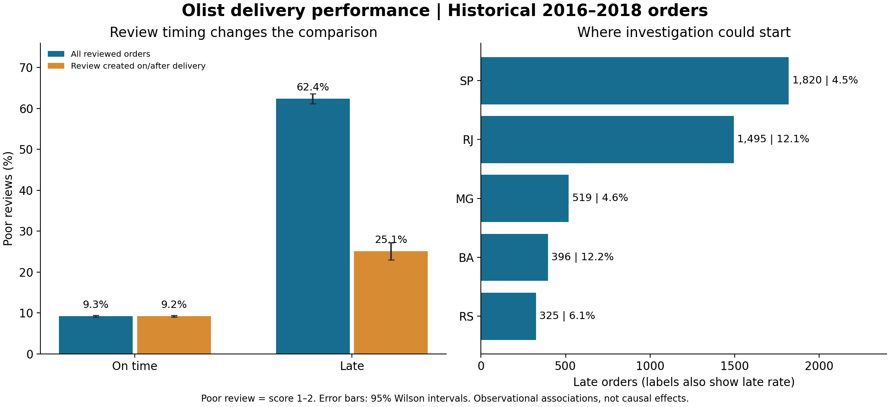

# E-commerce Delivery & Customer Experience

**Business question:** Where should an operations team investigate delivery problems, and how are missed delivery promises associated with customer reviews?

A reproducible analyst portfolio project using **Python, SQLite SQL, and Streamlit**, built from Olist's historical Brazilian marketplace data. It combines seven source tables into a validated, one-row-per-order analytical mart. This is independent portfolio work, not employment or consulting for Olist.



## Executive findings

- **6,534 of 96,470 eligible delivered orders arrived late (6.77%).** Median delivery took 10 calendar days; late deliveries missed the promise by a median of 7 days.
- Among reviewed orders, **62.42% of late orders received a score of 1–2**, versus **9.27% of on-time orders**. Denominators are 6,381 and 89,443 reviewed orders respectively.
- Restricting to review records created on or after delivery changes those rates to **25.09% and 9.25%**, on 1,630 and 89,218 orders. This is a sensitivity check, not a causal adjustment. Record creation is not necessarily when the customer submitted the review.
- São Paulo (SP) had the most late orders (**1,820**) but a **4.49%** late rate. Rio de Janeiro (RJ) had **1,495** late orders and a **12.11%** rate. Volume and rate answer different prioritization questions.
- The direction of the all-reviewed association persists in all **14 destination states** having at least 100 reviewed orders in each delivery group. This does not control for other confounders.

**Recommendation:** investigate RJ delivery lanes and high-volume SP exceptions, inspect seller handoff and carrier events, and pilot proactive delay communication. The data identifies where to investigate; it does not establish responsibility or financial savings. See [the management brief](reports/management_brief.md).

## Run locally

Requires Python 3.11+. The downloadable ZIP includes the generated order mart, so you can launch the dashboard after installing dependencies. A GitHub clone requires downloading and building the data first.

```bash
python -m venv .venv
# macOS/Linux
source .venv/bin/activate
# Windows PowerShell alternative: .venv\Scripts\Activate.ps1
pip install -r requirements.txt
python download_data.py
python analyze.py
python make_charts.py
python -m unittest discover -s tests -v
streamlit run dashboard.py
```

If Kaggle's anonymous download endpoint stops working, download the dataset from the [official page](https://www.kaggle.com/datasets/olistbr/brazilian-ecommerce) and place the seven CSV files listed in `download_data.py` inside `data/raw/`. No credential should be committed to this repository.

## Dashboard

- Filter by purchase-month range and destination state.
- Track eligible orders, late rate, median delivery duration, and late-order counts.
- Compare poor-review rates with an optional review-timing restriction.
- Explore destination, product-category and seller investigation queues.
- Export filtered queues; inspect quality checks and metric definitions.

The dashboard runs locally in Streamlit. It is not a Power BI file or an externally hosted application.

## What this demonstrates

| Analyst competency | Evidence |
|---|---|
| Business framing | Decision, stakeholder questions, acceptance criteria and action plan |
| SQL | Seven-table model, CTEs, pre-aggregation, window functions, unique order index |
| Data quality | Key and foreign-key validation, join reconciliation, date checks and source hashes |
| Statistics | Explicit denominators, Wilson intervals, review-timing sensitivity, state stratification |
| Communication | Executive chart, management brief, definitions and interview guide |
| Reproducibility | Official download script, pipeline, automated SQL tests and dashboard checks |

## Files

- `download_data.py`: official-source download of seven tables.
- `analyze.py`: builds `results/analytics.sqlite`, CSV outputs and JSON quality report.
- `sql/order_mart.sql`: one-row-per-order transformation.
- `sql/segment_performance.sql`: investigation queues, minimum 100 eligible orders.
- `dashboard.py`: local interactive dashboard.
- `make_charts.py`: regenerates the portfolio figure.
- `tests/test_sql.py`: synthetic boundary fixtures for SQL semantics and join safety.
- `DATA_DICTIONARY.md`: grain, fields, denominators and exclusions.
- `DATA_SOURCES.md`: provenance, licensing and transformations.
- `reports/`: management brief, business requirements, interview notes and chart.
- `results/`: computed summaries; large rebuildable database/mart excluded from Git.

## Limitations

Historical 2016–2018 Brazilian orders are not current Canadian benchmarks. Canceled, undelivered and invalid-date records are excluded from delivery-rate denominators, so this is not the failure rate for all purchases. Recent purchase cohorts may have incomplete delivery outcomes; sparse early months should not be interpreted as stable trends. Reviews are selected observations, not a random customer survey. The estimates are descriptive; 95% Wilson intervals assume independent Bernoulli outcomes and do not account for seller/customer clustering or selection bias. Seller rankings use single-seller orders and still cannot identify carrier versus seller responsibility. No profit, savings, conversion lift or causal impact is claimed.

Data and derived outputs are attributed to Olist and distributed under CC BY-NC-SA 4.0; see [DATA_SOURCES.md](DATA_SOURCES.md).

## BigQuery Sandbox extension

See [the cloud setup guide](cloud/README.md) for explicit source schemas, dbt models,
Console SQL and quality checks for `secret-drake-512620-i7`.
[Validation evidence](cloud/VALIDATION.md) separates the reproduced local results
from cloud deployment, which remains unverified.
